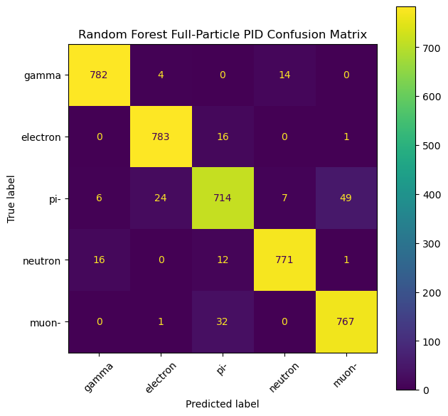
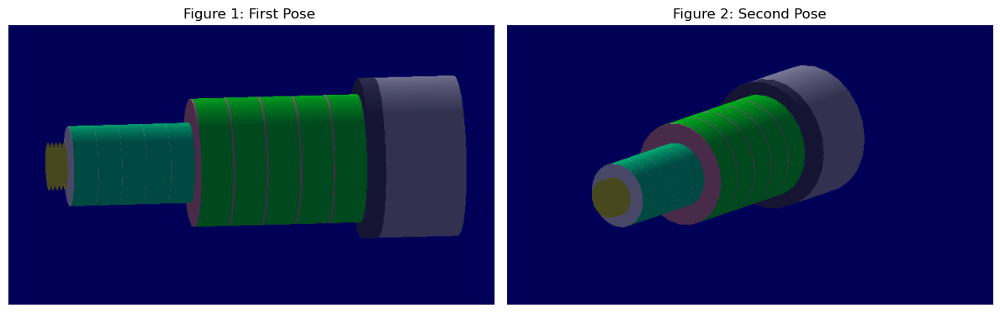
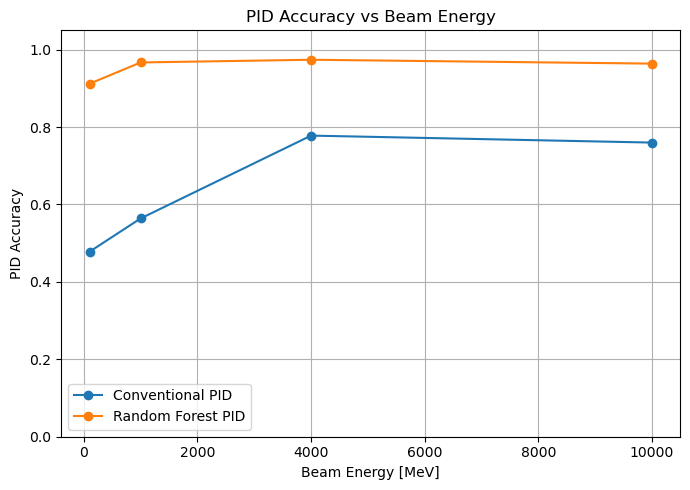
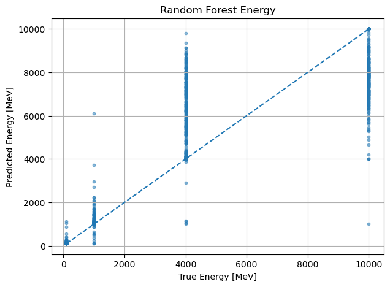
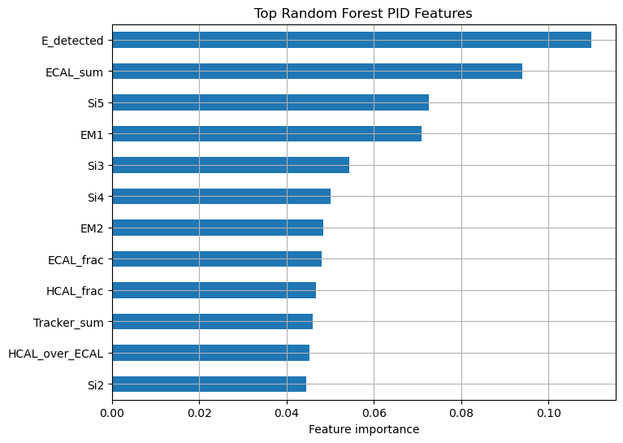
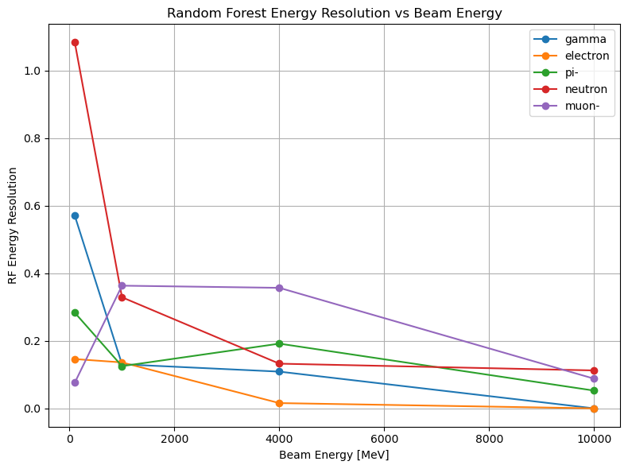

# Geant4 Particle-Detector Reconstruction with Machine Learning

**Saqib Umair**  
MSc Particle and Nuclear Physics, University of Edinburgh

This project compares conventional detector reconstruction with machine-learning methods using response data from a layered Geant4 particle-detector simulation.

The detector model contains a silicon tracker, sampling ECAL, sampling HCAL and a muon-sensitive layer. Five particle species are studied at four beam energies: photons, electrons, charged pions, neutrons and muons at 100 MeV, 1 GeV, 4 GeV and 10 GeV.

## Main results

| Task | Conventional method | Machine-learning method |
|---|---:|---:|
| Five-class particle identification | **64.5% accuracy** | **95.4% accuracy** |
| Energy reconstruction R² | **-0.570** | **0.939** (Random Forest) |
| Energy reconstruction RMSE | **4.85 GeV** | **0.957 GeV** (Random Forest) |

For the simpler photon/electron problem, the conventional detector-based rules already perform well, with **97.46% overall efficiency**. The larger gain from machine learning appears when all five particle species are reconstructed together.



## Detector representation

Each event contains:

- 5 silicon-tracker energy deposits;
- 5 ECAL layer deposits;
- 5 HCAL layer deposits;
- 1 muon-layer response;
- the true beam energy from the simulation.

Additional physics-motivated features are constructed from the layer responses, including total ECAL/HCAL energy, tracker activity, calorimeter energy fractions and simple longitudinal shower-shape variables.



## Particle identification

A conventional rule-based classifier uses tracker activity, ECAL and HCAL energy fractions, ECAL/HCAL balance and muon response.

On the same held-out test set:

- conventional five-class PID accuracy: **64.5%**;
- Random Forest PID accuracy: **95.425%**.

The Random Forest test set contains 800 events from each particle class. The remaining errors are concentrated mainly in pion classification.



The improvement is largest at low beam energy:

| Beam energy | Conventional PID | Random Forest PID |
|---:|---:|---:|
| 100 MeV | 47.8% | 91.2% |
| 1 GeV | 56.4% | 96.7% |
| 4 GeV | 77.8% | 97.4% |
| 10 GeV | 76.0% | 96.4% |

## Energy reconstruction

Three approaches are compared on the same 4,000-event test set:

| Method | MAE | RMSE | R² |
|---|---:|---:|---:|
| Global conventional calibration | 3.01 GeV | 4.85 GeV | -0.570 |
| Linear regression | 1.30 GeV | 2.04 GeV | 0.722 |
| Random Forest regression | **0.303 GeV** | **0.957 GeV** | **0.939** |

A single global calibration factor is not adequate for a mixed sample because photons, electrons, hadrons and muons have very different visible detector responses. The Random Forest can combine the subsystem information and nonlinear response patterns directly.



## Model interpretation

The most important Random Forest PID features include total detected energy, ECAL energy, silicon-layer deposits, ECAL fraction, HCAL fraction and total tracker response.



The energy-resolution study also shows that performance remains particle- and energy-dependent, particularly at low beam energy.



## Repository contents

```text
.
├── README.md
├── requirements.txt
├── notebooks/
│   └── geant4_detector_reconstruction_ml.ipynb
├── figures/
│   ├── detector_geometry.png
│   ├── rf_pid_confusion_matrix.png
│   ├── rf_pid_feature_importance.png
│   ├── conventional_energy_prediction.png
│   ├── linear_regression_energy_prediction.png
│   ├── rf_energy_prediction.png
│   ├── rf_energy_resolution_vs_energy.png
│   └── pid_accuracy_vs_energy.png
├── results/
│   ├── model_comparison.csv
│   └── pid_accuracy_by_energy.csv
└── data/
    └── README.md
```

## Reproducibility

The public notebook uses relative paths under `data/raw/` rather than machine-specific local paths. Raw simulation CSV files are not included in this repository.

The train/test split and Random Forest models use `random_state=42`.

## Tools

Python · pandas · NumPy · scikit-learn · Matplotlib · Geant4 simulation output

---

## Research portfolio

This repository is part of my physics research and scientific-computing portfolio. See my [GitHub profile](https://github.com/saqibumaircheema) for related work in detector instrumentation, particle-physics analysis, simulation, statistical inference and scientific machine learning.
